# CRACK Savegame Editor

A save editor for **[CRACK](https://store.steampowered.com/search/?term=CRACK%20Rafoli)** by Rafoli. Edit money, upgrades, robots, the shop, tools, the work order and much more. It ships as one portable `.exe` with a dark UI in English and German.

Unofficial fan tool, not affiliated with Rafoli.

[](../../releases/latest)
[](../../releases)


[](LICENSE)

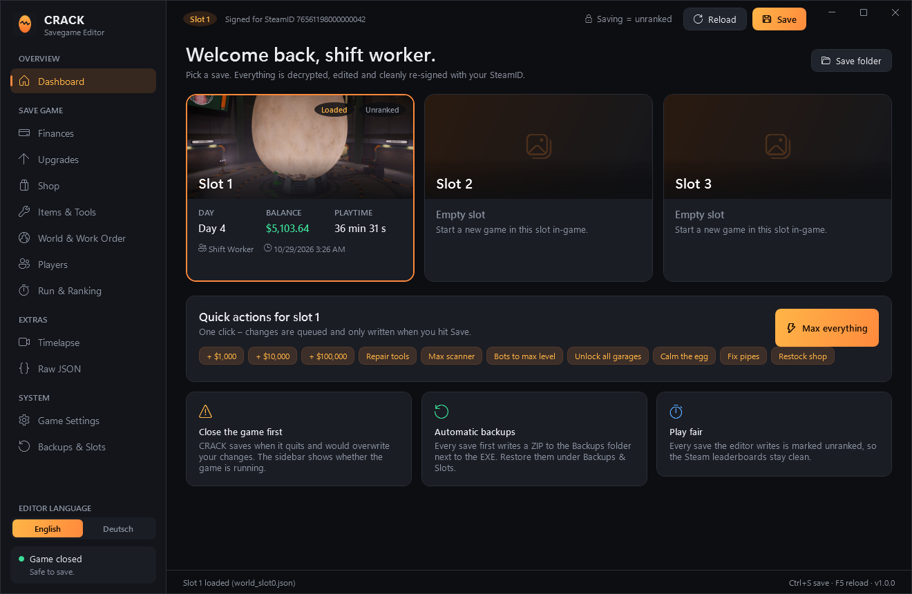

> [!IMPORTANT]
> **Using this editor makes your run unranked. Always, no exceptions.**
>
> CRACK has Steam leaderboards. To keep them fair, every save the editor writes is marked as *unranked* in the game's run record (`world_slotN.run`). This also applies to copying a slot, resetting to day 0 and restoring a backup. There is no setting to turn it off, and there never will be.
>
> Nothing changes for your own playthrough: the save loads and plays normally. It just no longer counts for the leaderboards.

## Download

1. Grab `CrackSaveEditor.exe` from the [latest release](../../releases/latest). There is nothing to install and no .NET runtime is needed (Windows 10/11 x64).
2. **Close CRACK.** The game saves when it quits and would overwrite your changes.
3. Start the editor. It opens your most recently played slot automatically.
4. Make your changes. The orange **Save** button shows how many changes are queued. Saving shows a list of every change (old → new) before anything is written.

Before every write the editor puts a ZIP of the slot into a `Backups` folder next to the exe.

## Features

| | |
|---|---|
| **Dashboard** | All 3 slots with day, balance, playtime, ranked status and the latest timelapse frame. Quick actions such as *+$10,000*, *Repair tools*, *Calm the egg* and *Max everything*. |
| **Finances** | Balance, total income and expenses per player (edited in dollars, stored in cents), plus total shop spending. |
| **Upgrades** | All 5 scanner tracks with their real tier values and prices, levels for all 8 robots, garage terminals, golf cart tiers and keypads. |
| **Shop** | Restock every item, then add, edit or remove daily deals (up to 100 % off) or put everything on sale. |
| **Items & Tools** | Every object in the world with its real name, durability (*Repair all*), location and origin. Duplicate, delete or spawn items *(experimental)*. |
| **World & Work Order** | Day, playtime, egg agitation, calming steps, burst pipes and flooding. Complete the current work order step. |
| **Players** | Nights in bed, reset seen tips, handbook entries, the announcement history and lifetime shift stats. |
| **Run & Ranking** | Read-only view of the run record: ranked status, run time and signature. |
| **Timelapse** | Browse and play the hourly photos the game takes of the egg, and export them as a looping GIF. |
| **Raw JSON** | Tree view of the whole decrypted save with search and type-safe editing. Export and import the decrypted JSON. |
| **Game Settings** | `settings.json`: FOV beyond the menu limit, audio, graphics, language and toggles. |
| **Backups & Slots** | Restore or delete backups, copy a slot to another slot, reset a slot to day 0, delete a slot. |

Item names, prices, max levels, max durability and catalogs come straight from the game files (see [tools/extract_gamedata.py](tools/extract_gamedata.py)), so the limits match the game.

### Language

The editor starts in English. Switch to **Deutsch** at the bottom of the sidebar; the choice is remembered (`%LOCALAPPDATA%\CrackSaveEditor\editor.json`). Item names use the game's own translations.

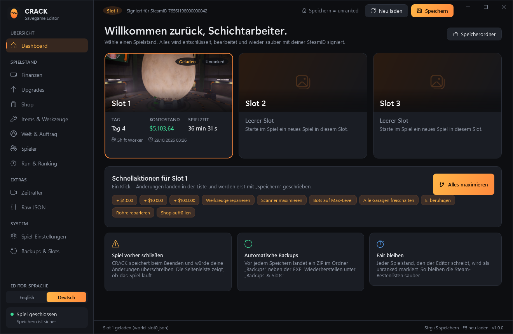

## Screenshots

| | |
|---|---|
| 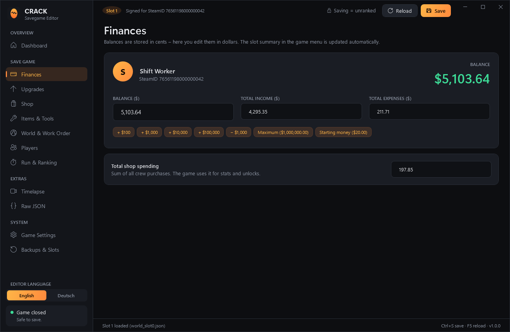 | 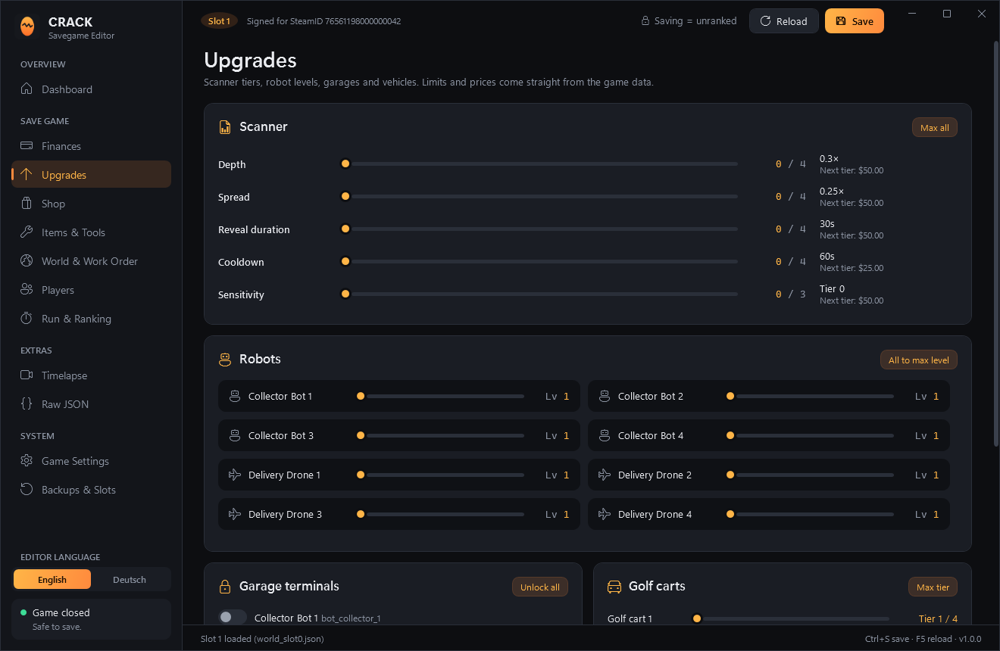 |
| **Finances** | **Upgrades** |
| 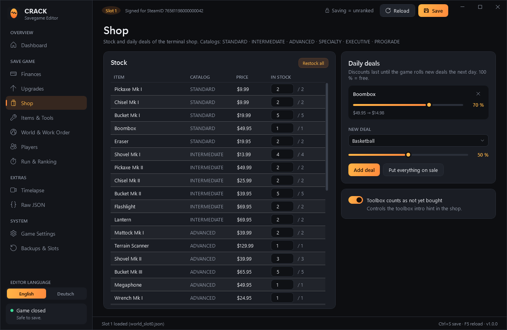 | 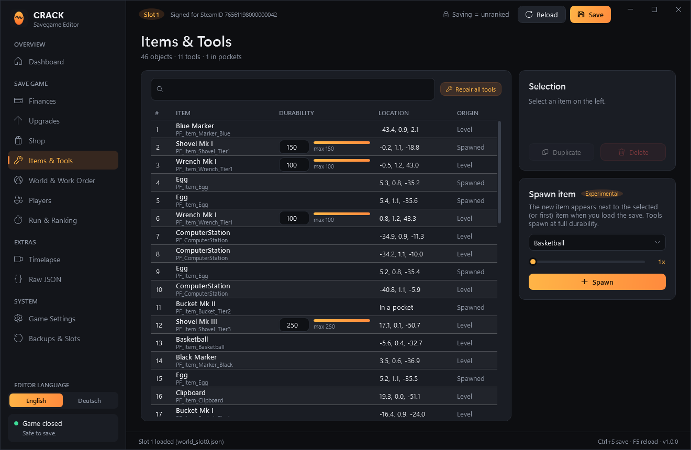 |
| **Shop** | **Items & Tools** |
| 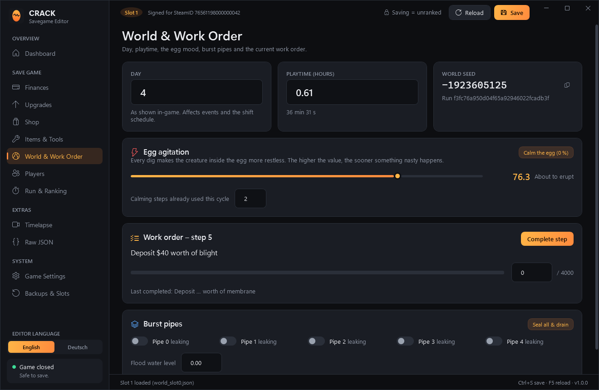 | 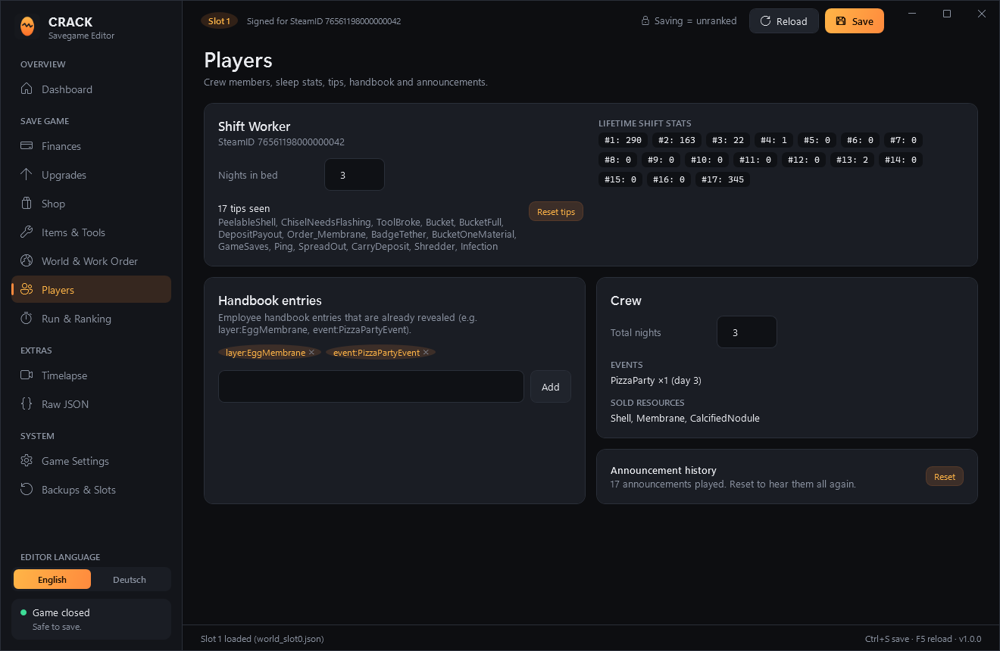 |
| **World & Work Order** | **Players** |
| 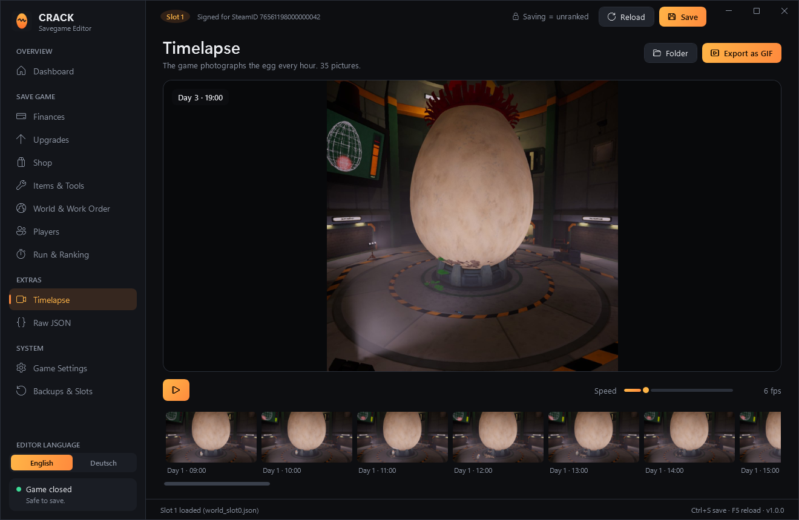 | 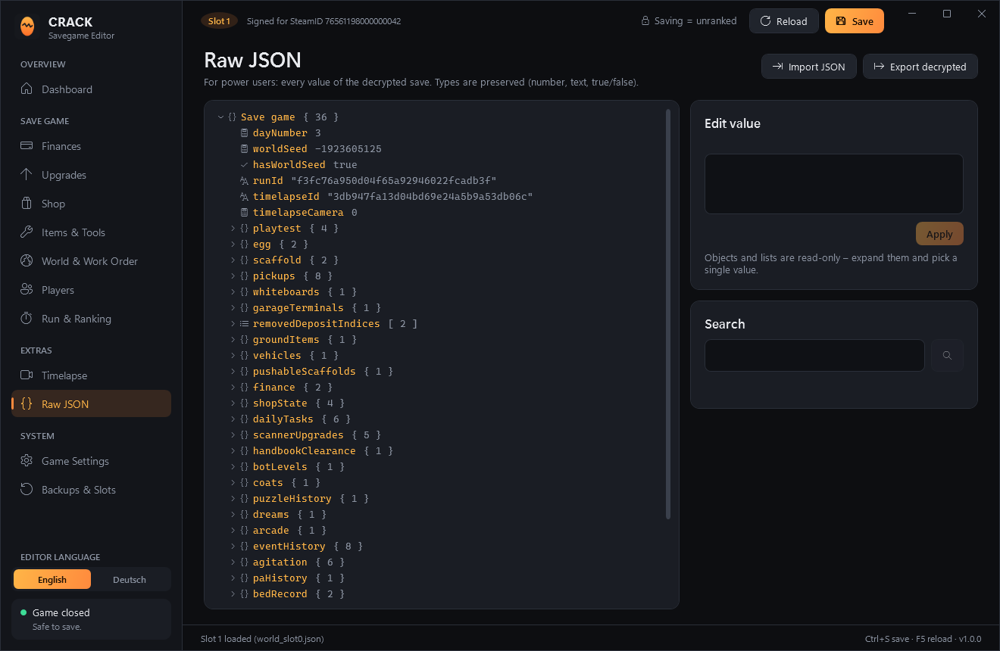 |
| **Timelapse** | **Raw JSON** |
| 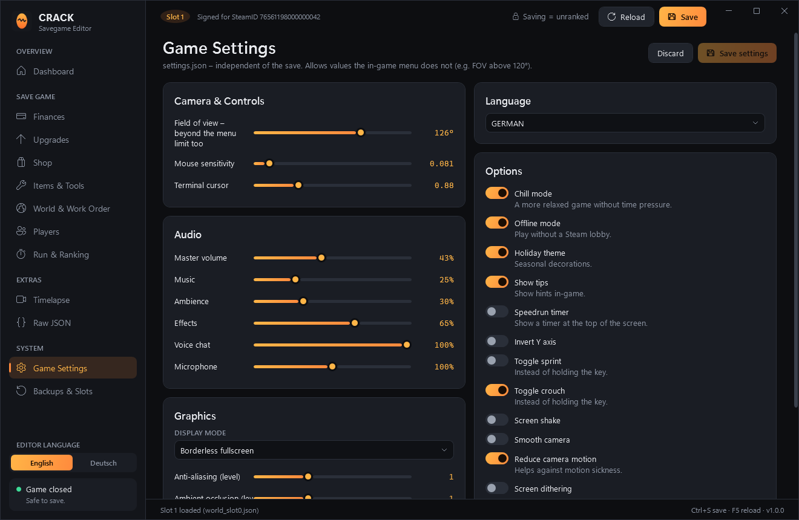 | 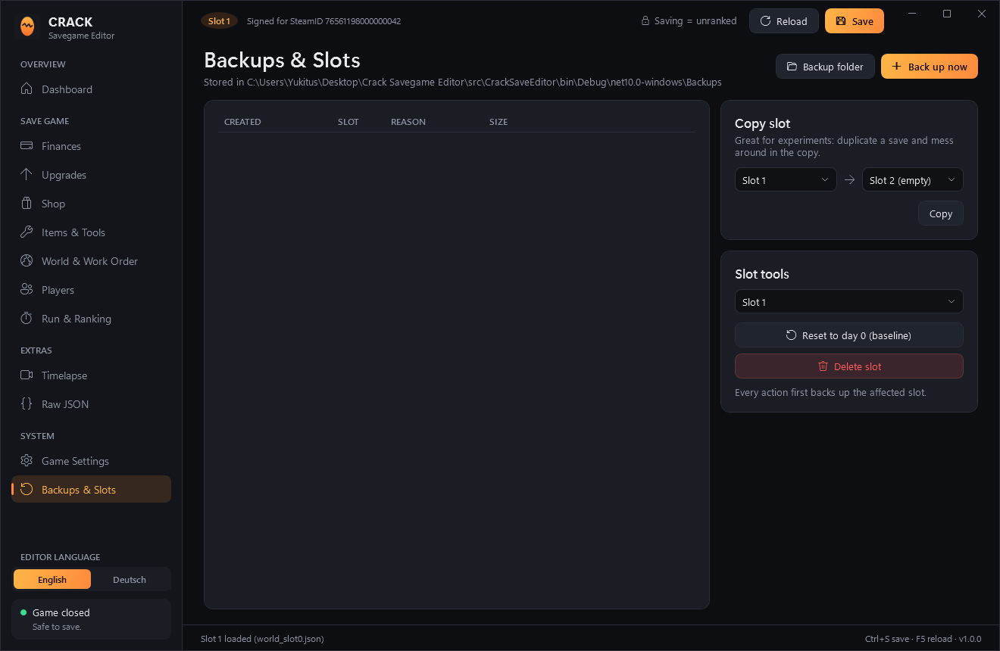 |
| **Game Settings** | **Backups & Slots** |
| 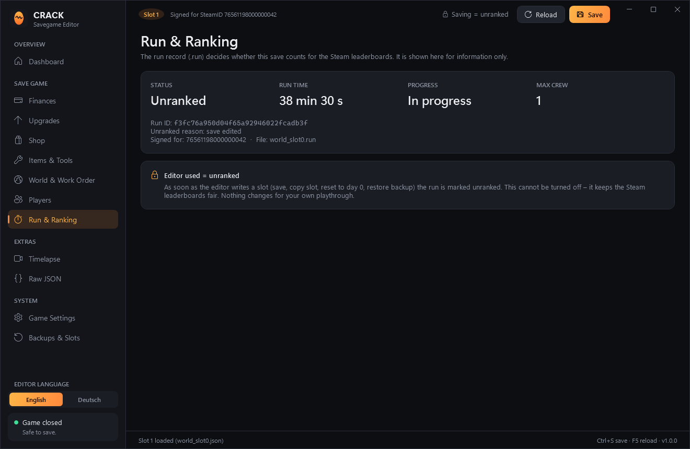 | |
| **Run & Ranking**: editor used = unranked | |

Screenshots were taken from an anonymized demo copy of a save.

## Save format

Saves live in `%USERPROFILE%\AppData\LocalLow\Rafoli\CRACK\`:

| File | Content |
|---|---|
| `world_slotN.json` | Checkpoint (encrypted) |
| `world_slotN_baseline.json` | Day-0 snapshot (encrypted) |
| `world_slotN.run` | Run record: `runId`, `ranked`, `unrankedReason`, `elapsedSeconds`, … (encrypted) |
| `world_slotN.meta.json` | Plain slot summary for the menu: `day`, `balanceCents`, `saveVersion` |
| `world_slotN_timelapse\*.jpg` | Hourly photos of the egg |
| `settings.json` | Plain game settings |

Encrypted files:

```
"CRK1" | IV (16) | AES-256-CBC / PKCS7 ciphertext | HMAC-SHA256 tag (32)

encKey = SHA256(UTF8("crack/save/v1/9f4c2e7a1b6d83f05e2a4c91d7b38e6f0a5c1d9e2b7f4a63|enc"))
macKey = SHA256(UTF8("crack/save/v1/9f4c2e7a1b6d83f05e2a4c91d7b38e6f0a5c1d9e2b7f4a63|mac"))
tag    = HMAC-SHA256(macKey, everything before the tag ++ int64 LE hostSteamId)
```

The plaintext is Unity `JsonUtility` JSON. The tag is bound to the SteamID64 of the host (0 when Steam is not running). The game still loads a save with a wrong tag, but it marks the run unranked ("save written by another player"). The editor finds the right SteamID by checking local Steam accounts and the save's own player list, and re-signs with it. See [Core/SaveCrypto.cs](src/CrackSaveEditor/Core/SaveCrypto.cs).

Untouched values keep their exact original text (`System.Text.Json.Nodes`), so an unedited save round-trips byte for byte.

## Build

Requires the .NET 10 SDK.

```powershell
./publish.ps1          # -> dist/CrackSaveEditor.exe (self-contained single file)
```

Command-line switches for development:

| Switch | Effect |
|---|---|
| `--selftest` | Decrypt / re-encrypt / signature round trip on your saves (read-only) |
| `--selftest --write` | Additionally edits and saves a copy of the save folder in `%TEMP%` |
| `--savedir <path>` | Use another save folder |
| `--lang en\|de` | UI language for this run only |
| `--shot <dir>` | Render every page to PNG and exit |

`Resources/GameData.json` is generated from a local game install:

```powershell
pip install UnityPy TypeTreeGeneratorAPI
python tools/extract_gamedata.py "<Steam>\steamapps\common\CRACK\CRACK_Data" src/CrackSaveEditor/Resources/GameData.json
```

## License

[MIT](LICENSE). CRACK and its assets belong to Rafoli.
